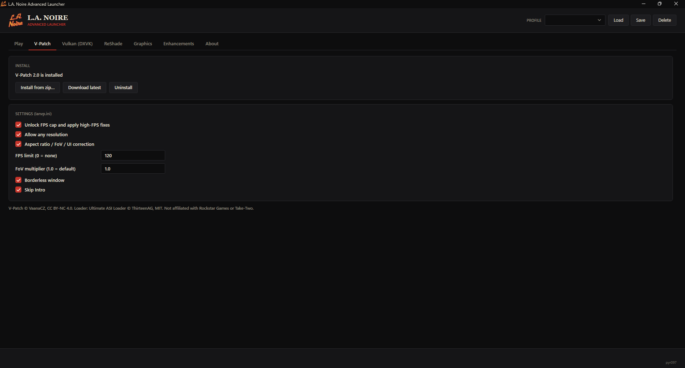
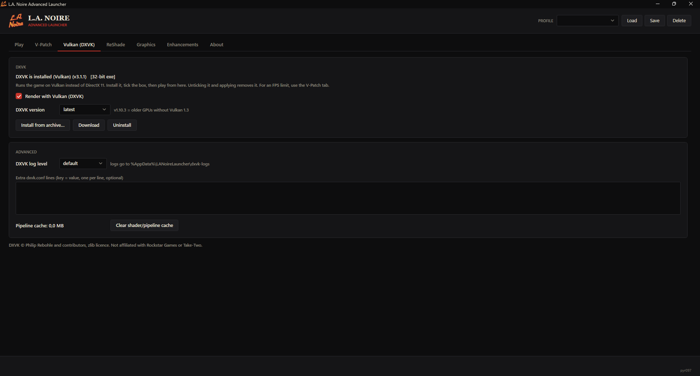
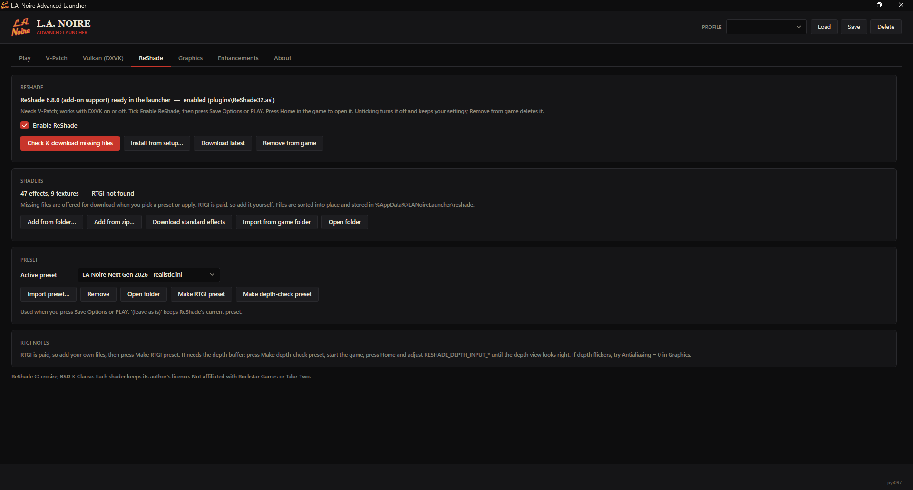
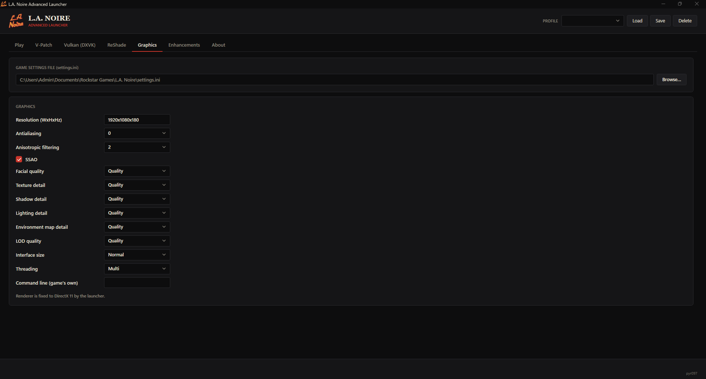
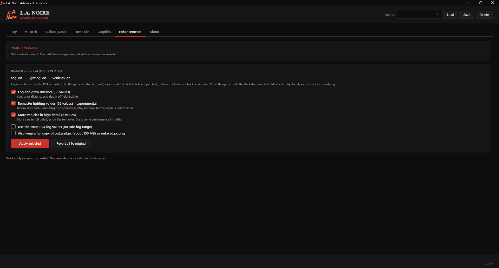
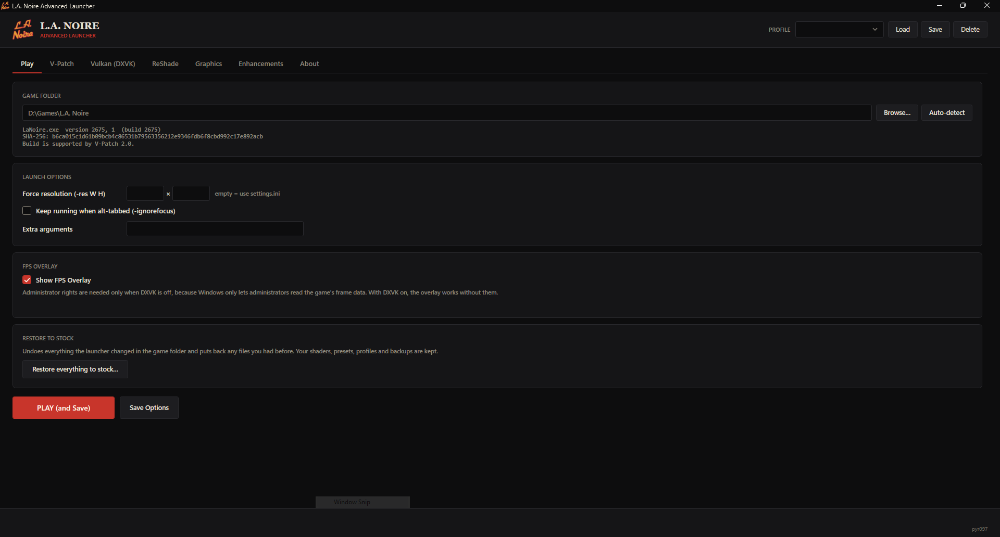

# L.A. Noire Advanced Launcher
Unlocked FPS, Vulkan, Reshade and much more

<p align="center">
  <a href="docs/screenshots/play.png"></a>
  <a href="docs/screenshots/vpatch.png"></a>
  <a href="docs/screenshots/vulkan.png"></a>
</p>
<p align="center">
  <a href="docs/screenshots/reshade.png"></a>
  <a href="docs/screenshots/graphics.png"></a>
  <a href="docs/screenshots/enhancements.png"></a>
</p>

A Windows launcher for the PC version of L.A. Noire. It works on the Rockstar Launcher, Steam and "other" versions. Latest game build is recommended. It sets up V-Patch, optional Vulkan rendering (DXVK), optional ReShade with presets, remaster-style enhancements (data patches and HD textures built from your own PS4 files), graphics settings and launch options in one window, and starts the game.

It works only on **your own** install. It never ships or repackages game files and does not touch or bypass any DRM; it just starts `LaNoire.exe`.

## How it works

1. **Find the game.** It reuses the remembered folder or looks in the usual Rockstar and Steam locations; otherwise use **Browse...** and pick `LaNoire.exe`.
2. **Check the install.** It reads the exe's build, 32/64-bit type and SHA-256, and warns if the build is not one V-Patch 2.0 supports (2617, 2663, 2675).
3. **Load settings** from `plugins/lanvp.ini` (V-Patch) and the game's `settings.ini`.
4. **Change things.** Nothing is written until you press **Save Options** or **PLAY (and Save)**.
5. **Apply.** The form is validated, each file is backed up, then written. It refuses to apply while the game is running.
6. **Play.** **PLAY (and Save)** applies everything and starts `LaNoire.exe` with your launch options (plus the DXVK environment variables when Vulkan is on).

## Features

### Play
- Game folder: auto-detect, Browse..., and a readout of the game's build and V-Patch support.
- Launch options: force resolution (`-res W H`), keep running when alt-tabbed (`-ignorefocus`), extra arguments.
- **Show FPS Overlay:** shows the FPS on top of the game using DXVK's own counter, so it is **only available when DXVK is on** (the checkbox is disabled otherwise and your choice comes back when DXVK is turned on again). **Ctrl+Shift+F** hides/shows the launcher's small "DXVK" label. It needs no administrator rights and nothing is injected into the game.
- **PLAY (and Save)** applies everything and starts the game. **Save Options** only applies.
- **Restore everything to stock...** (see below).

### V-Patch
- **Install from zip...** (a release zip you provide) or **Download latest** (GitHub). **Uninstall** removes only what the launcher added and restores a `dinput8.dll` you had before.
- `lanvp.ini` settings: FPS unlock, any resolution, aspect ratio / FoV / UI correction, FPS limit (needs FPS unlock), FoV multiplier (needs aspect correction), borderless window, Skip Intro (skips the company logos and legal screens). A warning appears if the FPS limit or FoV multiplier would have no effect.
- V-Patch creates `lanvp.ini` the first time the game runs; if it is missing, run the game once.

### Vulkan (DXVK)
- DXVK runs the game on Vulkan instead of DirectX 11 (current DXVK needs a Vulkan 1.3 driver; pick `v1.10.3` for older GPUs).
- **Install from archive...** or **Download** gets DXVK ready. **Render with Vulkan (DXVK)** switches it on or off when you apply. **Uninstall** removes it and restores any DLLs you had before.
- Advanced: log level, extra `dxvk.conf` lines, clear the shader cache.
- To limit FPS, use the FPS limit in the V-Patch tab (any `maxFrameRate` in `dxvk.conf` is ignored).

### ReShade
Works with DXVK on or off. Needs V-Patch installed.

- **Runtime:** **Install from setup...** takes the files from a ReShade setup exe, zip or dll. **Download latest** fetches the version with add-on support from reshade.me.
- **Enable ReShade** (applied with Save Options / PLAY) turns ReShade on in the game. Unticking turns it off but keeps your settings. If you installed ReShade yourself, the launcher detects it and won't enable a second copy; use **Import from game folder** to keep its shaders and presets, then remove it. **Remove from game** deletes ReShade from the game folder completely.
- **Shaders:** **Add from folder / zip...** sorts a shader pack into place; **Download standard effects** fetches the standard ReShade effects. Everything is stored in `%AppData%\LANoireLauncher\reshade`, not in the game folder.
- **Default preset:** the launcher includes `LA Noire Next Gen 2026 - realistic.ini`. It is added right after ReShade is first installed (never overwriting an existing preset of that name) and is selected if you have not chosen another preset.
- **Presets:** import, choose the active one (used when you apply; "(leave as is)" keeps ReShade's current preset), remove, or open the folder. The preset is saved in profiles.
- **Missing files:** when you pick a preset, tick Enable ReShade, press Save Options / PLAY, or press **Check & download missing files**, the launcher lists what the preset still needs and offers to download it in one go from the packs those effects come from ([iMMERSE](https://github.com/martymcmodding/iMMERSE), [LumeniteFX](https://github.com/umar-afzaal/LumeniteFX), [qUINT](https://github.com/martymcmodding/qUINT), [SweetFX](https://github.com/CeeJayDK/SweetFX), ReShade's standard effects). Existing files are never replaced. Anything it can't fetch is listed with the reason.
- **RTGI** is a paid shader, so it is not downloaded. Add your own files, then **Make RTGI preset**. RTGI needs the game's depth buffer: **Make depth-check preset** (needs `DisplayDepth.fx`), start the game, press Home and adjust the `RESHADE_DEPTH_INPUT_*` options until the depth view looks right.
- If ReShade does not appear in the game, check `ReShade.log` in the game folder.

### Graphics
Edits the game's `settings.ini` (found automatically, or use **Browse...**): resolution, antialiasing, anisotropic filtering, SSAO, facial quality, detail levels, interface size and threading. Dropdowns are editable.

- **DirectX 11 always:** applying forces it.
- **Windowed or borderless only:** applying sets Fullscreen to NO; the "Borderless window" checkbox picks which.

### Enhancements (work in progress)
Experimental and still being developed. It copies selected values from the PS4 remaster into the game's data file (`final\pc\out.wad.pc`). The values come from comparing the PC and PS4 files of your own copies; no game data is shipped. Tick the sets you want and press **Apply selected**: ticked sets are patched, unticked sets are set back to original.

- **Fog and draw distance (38 values):** subtle.
- **Remaster lighting values (66 values), experimental:** bloom, light radius, brightness/contrast. They may not look better, and neon signs are not affected.
- **More vehicles in high detail (2 values).**
- Options: use the exact PS4 fog values, and keep a full copy of the original file (`out.wad.pc.orig`, about 150 MB).

Safety: every value is checked first (a mismatch changes nothing), and **Revert all to original** restores the exact original bytes. This tab is independent of Save Options and profiles, and refuses to run while the game is running. The Rockstar launcher's file check may flag the change, so revert before verifying.

**HD textures (PS4 remaster).** The PS4 version has higher-resolution textures for many cars, props, characters and world surfaces (for example a 128x128 PC texture is 512x512 on PS4). This part of the tab brings them to the PC game without changing any game archive, in three steps:
1. **Your PS4 files:** pick the folder with your own `.big.ps4` files (or a parent of it). Nothing is copied from it except what the build below converts.
2. **Build or extend the pack:** tick the groups you want (vehicles, props, props high detail, characters, character textures, world textures, or all) and press **Build / extend pack**. It runs the bundled tool (`lan_tex_tools.py`, unpacked to `%AppData%\LANoireLauncher\tools`) with your 64-bit Python 3; if numpy is missing the launcher offers to install it with pip. The tool pairs PC and PS4 resource packs by their entry IDs, then pairs textures **exactly by the texture IDs stored in each pack's texture table** (the same on both platforms); a loose picture-similarity check skips an ID match whose pictures look unrelated. Packs without a texture table fall back to matching by picture content (the *match threshold*, default 0.85). It detiles the PS4 textures (GNF, 1D tiling, BC1/BC3) and writes standard DDS files plus a list into `<game>\hdpack`. **Analyze coverage** answers "which groups should I build?": with the diagnostic log on, play a few minutes, close the game and press it. The tool looks up every texture the game uploaded in the PC archives and reports, per archive, how many have a larger PS4 version, how many are already the same size, how many have no PS4 counterpart, and how many the game loaded that are not in the scanned archives at all. It only reads. At the end of a build it reports how many textures have a larger PS4 version, how many are already the same size, and how many have no PS4 counterpart (reworked in the remaster). Each run **adds** to the same pack, so you can go one group at a time and **Cancel** at any point; **Start a new pack** deletes the old one first. A live log is shown in the tab.
3. **HD texture plugin:** **Install / update plugin** copies `LanTexReplace.asi` into `<game>\plugins`, where V-Patch's ASI loader starts it with the game. The plugin identifies each texture when the game uploads it (CRC32 of the top mip, the same value the tool stored), builds the larger texture and swaps the view the game binds. Options: **Enable HD textures** (Replace on/off), **HD memory limit (MB)** (default 1024; replacements beyond it are skipped) and an optional diagnostic log (`plugins\LanTexReplace.log`). Press **Apply texture settings** to write `plugins\LanTexReplace.ini`.

Notes: it works with the DirectX 11 path (including Vulkan through DXVK), not DirectX 9, and only for the 32-bit game executable. Only BC1/BC3 textures whose PS4 copy is larger and clearly the same picture are replaced. The released launcher carries the compiled plugin; when you build the launcher yourself without it, **Install** asks for a `LanTexReplace.asi` (build it with `Plugin\build_msvc.bat`). The pack is derived from game assets: keep it on your PC and do not share it.

### About (updates)
- **Check for updates** looks at the newest release of this repository. It also does this in the background at startup (silently if offline); both can be turned off.
- **Download and install** asks first, downloads the new exe, verifies it, then replaces itself. If anything fails, the old launcher stays.
- **Skip this version** hides a release from the automatic check.
- **Close the launcher after starting the game** (not applied while the FPS overlay is on, since the launcher draws it).
- **Open GitHub page** and **Open data folder** (`%AppData%\LANoireLauncher`).

## Restore to stock
**Restore everything to stock...** undoes every launcher change to the game folder, in order: ReShade, DXVK, Enhancements (exact revert, then `out.wad.pc.orig` is deleted), the HD texture plugin (your built pack is kept), V-Patch, then `settings.ini` (back to the first version the launcher saw). Only files the launcher installed are touched, and files that existed before (such as a previous `dinput8.dll` or `ReShade.ini`) are put back. Shaders, presets, profiles and backups in `%AppData%` are kept.

## Profiles
The profile box (top right) saves, loads and deletes named profiles: V-Patch and graphics fields, resolution, `-ignorefocus`, extra arguments, DXVK settings, and ReShade on/off with the chosen preset. **Load** only fills the form; press Save Options to write it.

## Safety and data
- Every file is backed up to `%AppData%\LANoireLauncher\backups\<timestamp>` before it is changed; the first `settings.ini` is kept in `...\original`.
- Only files the launcher added are removed on uninstall (tracked in `...\manifests`); with no record, nothing is deleted.
- V-Patch, DXVK, ReShade and shaders are never bundled; they come from an archive you pick or from GitHub at runtime. Two small files are embedded: the default preset (copied only after ReShade is installed) and `Fxaa3_11.h` (NVIDIA FXAA 3.11 by Timothy Lottes, which `FXAA.fx` includes and ReShade's slim branch omits), written next to `FXAA.fx` only if no copy exists.
- The launcher never asks for administrator rights. If the game sits in a write-protected folder (typically `C:\Program Files`), the launcher says so under the game folder and installing V-Patch, DXVK or ReShade there will fail: move the game to a normal folder (for example `D:\Games`) or start the launcher once with right-click > Run as administrator.
- HD textures: the texture tool is embedded in the exe and unpacked to `%AppData%\LANoireLauncher\tools` when used; the plugin is compiled from `Plugin\` and embedded. The pack is built from files you provide, stays on your PC, and only the plugin reads it. No game archive is modified.
- Launcher data (config, profiles, backups, manifests, caches, logs, ReShade runtime, shaders, presets, the texture tool) lives in `%AppData%\LANoireLauncher`. The game folder only gets the files described above (V-Patch, DXVK, `plugins\ReShade32.asi`, `ReShade.ini`, and for HD textures `plugins\LanTexReplace.asi` / `.ini` and the `hdpack` folder).

## Requirements
- Windows 10 or 11 (64-bit) and the [.NET 8 Desktop Runtime](https://dotnet.microsoft.com/download/dotnet/8.0/runtime). If it is missing, Windows shows its own message with the download link.
- Only for building an HD texture pack: 64-bit [Python 3.8+](https://www.python.org/downloads/) (the launcher offers to install the `numpy` package it needs) and your own PS4 files. Playing with an existing pack needs neither.
- The [Microsoft Visual C++ Redistributable (x64)](https://learn.microsoft.com/cpp/windows/latest-supported-vc-redist) for the FPS overlay. At startup the launcher checks for it and, if it is missing, shows a message with the download link.

## Build and release
Requires the .NET 8 SDK on Windows. Run `dotnet publish -c Release` (or do a Release build in Visual Studio) to get a single exe at `dist\LANoireLauncher.exe`. Add `-p:SelfContained=true` to include the .NET runtime: bigger, but runs anywhere. `dotnet run` is for development.

The version comes from a git tag: pushing one runs `.github/workflows/release.yml`, which builds the exe, writes a SHA-256 file and publishes a GitHub release (a tag with a dash, such as `v1.2.0-beta.1`, becomes a pre-release). Local builds use `<Version>` in `LANoireLauncher.csproj`. The workflow also compiles the 32-bit HD texture plugin from `Plugin\` (MSVC, x86) and embeds it. For a local build with the plugin: run `Plugin\build_msvc.bat` from the "x86 Native Tools Command Prompt for VS", then build the launcher; without `Assets\LanTexReplace.asi` the launcher still builds and asks for the file at install time.

build.bat for a faster build (put in main project folder): 

@echo off
rem Builds LANoireLauncher into ONE exe at .\dist\LANoireLauncher.exe
rem   build.bat         -> small exe, needs the .NET 8 Desktop Runtime on the PC
rem   build.bat full    -> bigger exe with the runtime inside, runs anywhere
cd /d "%~dp0"
if exist dist rmdir /s /q dist
if /i "%~1"=="full" (
  dotnet publish LANoireLauncher.csproj -c Release -p:SelfContained=true -p:NoPublishAfterBuild=true -o dist
) else (
  dotnet publish LANoireLauncher.csproj -c Release -p:NoPublishAfterBuild=true -o dist
)
if errorlevel 1 ( echo Build failed. & pause & exit /b 1 )
echo.
echo Done: %~dp0dist\LANoireLauncher.exe
pause


```
git tag v2.6.5
git push origin v2.6.5
```

## Project layout
- `MainWindow.xaml` / `.xaml.cs`, `MainWindow.ReShade.cs`, `MainWindow.HdTextures.cs`, `MainWindow.Update.cs`, `MainWindow.Restore.cs`: the UI and its logic.
- `Theme.xaml`, `App.xaml` / `.xaml.cs`: styles, startup and the dependency check.
- `Core/`: `GameInstall`, `PatchManager` (V-Patch), `DxvkManager`, `ReShadeManager` (+ `.Dependencies`), `AtbPatcher` (Enhancements), `HdTextureManager` (HD textures), `UpdateManager`, `DependencyCheck`, `IniDocument`, `Field`, `LauncherConfig`.
- `Overlay/`: the small "DXVK" label shown next to DXVK's own FPS counter.
- `Plugin/`: source of the 32-bit D3D11 plugin (`LanTexReplace.cpp`, `lantex_core.h`, `build_msvc.bat`). `Assets/lan_tex_tools.py`: the texture pack tool (embedded).

## What's new in 2.6.5 Final
- **No more administrator rights.** The launcher no longer asks to restart as administrator at startup, and the updater no longer elevates.
- **FPS overlay only with DXVK.** The overlay now always uses DXVK's own counter (no Windows tracing, so nothing needs elevated rights). With DXVK off the checkbox is disabled; your choice is remembered and comes back when DXVK is turned on again. The Windows-based counter and its `TraceEvent` dependency were removed.
- If the game folder is write-protected (typical for Program Files), the launcher now tells you under the game folder.

## What's new in 2.6.4 (internal release, integrated in 2.6.5 Final)
- **HD textures: Analyze coverage.** A new button reads the plugin's diagnostic log and shows, per archive, where the textures you saw in-game come from and how many have a larger PS4 version, so you know which groups are worth building. (Standalone: `lan_tex_tools.py explain`.)
- The diagnostic log now records every texture upload (before, only the first 2000), and its final line shows the peak HD memory (`peakHdMB`).

## What's new in 2.6.3 (internal release, integrated in 2.6.5 Final)
- **HD textures: settings now always save.** The enable switch, memory limit and diagnostic log save the moment you change them, and again whenever you press Apply or Apply and Launch. Before, they were only saved by their own button and could silently revert.
- **The plugin file is checked.** Install refuses any file that is not the 32-bit HD texture plugin (installing another .asi under its name, for example a copy of `lanvp.asi`, makes V-Patch load twice and fail with "No signatures found"). The panel also shows which `.asi` files the loader starts, warns about identical copies and about an invalid plugin file, shows when the log was last written, and has an **Open log** button.
- **The plugin stays out of the way at startup.** It now does nothing until the game itself has loaded `d3d11.dll`, so it can no longer interfere with V-Patch or ReShade while they initialise. With logging on it always writes the log header immediately, even when it has nothing to hook (for example on the DirectX 9 path).

## What's new in 2.6.2 (internal release, integrated in 2.6.5 Final)
- HD textures: the build log ends with a per-archive table (textures found, upgraded, already the same size, no PS4 counterpart, unsupported PS4 format), so you can see which archives are worth building.

## What's new in 2.6.1 (internal release, integrated in 2.6.5 Final)
- HD textures: the pack builder now pairs textures by the exact IDs in each pack's texture table (with a picture sanity check) instead of guessing from pictures. This is safer and gives a precise report. Small DLC archives that are not compressed are handled too.

## What's new in 2.6.0 (internal release, integrated in 2.6.5 Final)
- **Enhancements: HD textures from the PS4 remaster.** Build a pack from your own PS4 files and enable it with a small plugin (see above). Includes a live build log, cancel, extend-the-pack runs, and a memory limit.
- Restore to stock also removes the HD texture plugin (your pack is kept).
- The release workflow compiles the plugin and embeds it in the exe.


## What's new in 2.5.7 Final - Initial public release (run as administrator if you want dx9 fps overlay).

## Credits and licences
- **V-Patch** by VaanaCZ, [github.com/VaanaCZ/LANVP](https://github.com/VaanaCZ/LANVP), CC BY-NC 4.0 (non-commercial). Installed on request, not included.
- **Ultimate ASI Loader** by ThirteenAG, MIT; it is the `dinput8.dll` inside the V-Patch release.
- **DXVK** by Philip Rebohle and contributors, [github.com/doitsujin/dxvk](https://github.com/doitsujin/dxvk), zlib. Downloaded on request.
- **ReShade** by crosire, [reshade.me](https://reshade.me), BSD 3-Clause. Downloaded on request. Shaders (including RTGI) keep their authors' licences and are not included.
- **iMMERSE** and **qUINT** by Pascal Gilcher (Marty McFly), **LumeniteFX** by Umar Afzaal, **SweetFX** by CeeJay.dk. Downloaded from their repositories on request; each keeps its author's licence.
- The HD texture tool and plugin are original code written for this launcher. The community notes on the game's archive formats (for example [Baromir19/LANoireTools](https://github.com/Baromir19/LANoireTools), MIT) were a useful reference. Texture data comes only from files you provide.
- **.NET 8 and WPF** by Microsoft.

AI was used to make this. L.A. Noire is a trademark of Rockstar Games / Take-Two Interactive. This launcher is not affiliated with or endorsed by Rockstar Games, Take-Two, V-Patch, DXVK or ThirteenAG.
