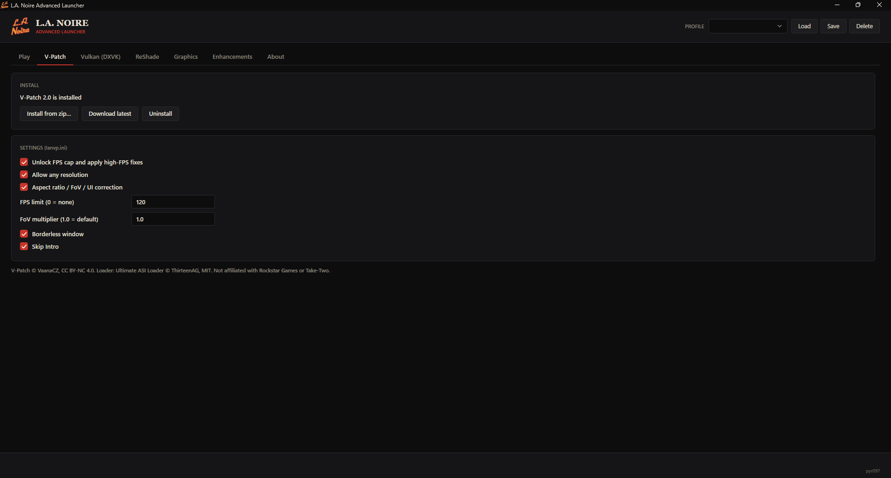
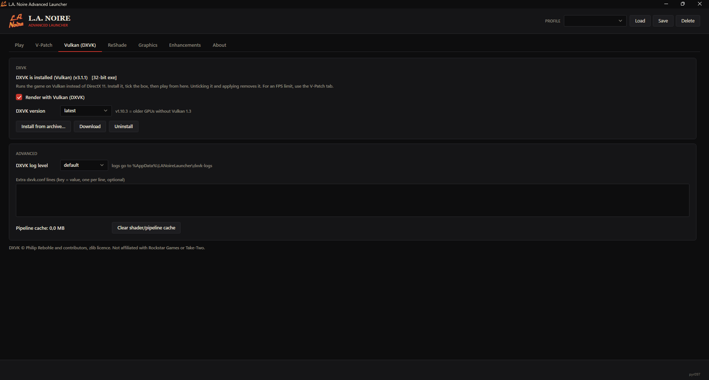
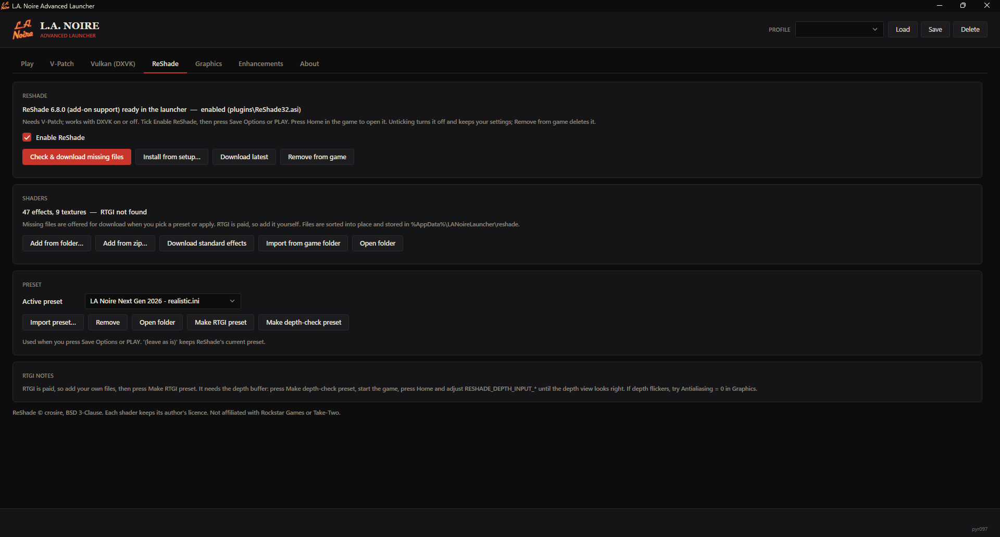
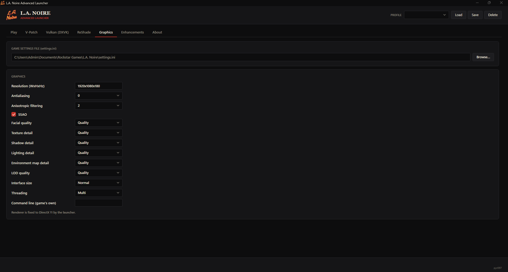
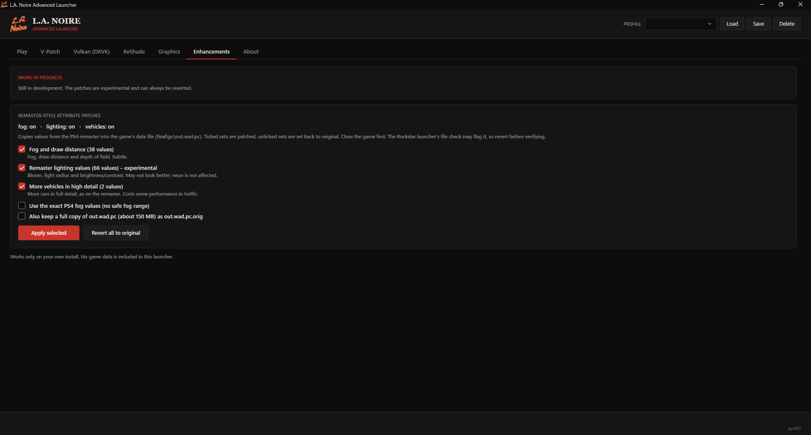
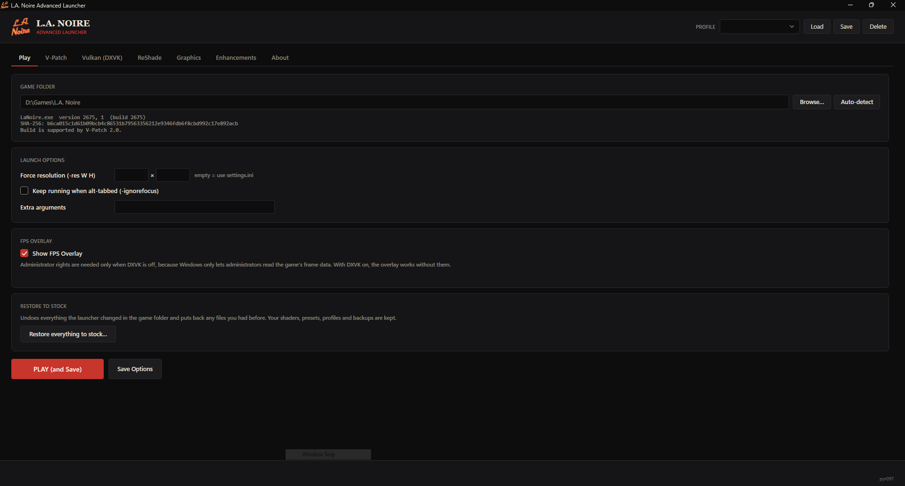

# L.A. Noire Advanced Launcher
(Unlocked FPS, Vulkan, Reshade and much more)

<p align="center">
  <a href="docs/screenshots/play.png"></a>
  <a href="docs/screenshots/vpatch.png"></a>
  <a href="docs/screenshots/vulkan.png"></a>
</p>
<p align="center">
  <a href="docs/screenshots/reshade.png"></a>
  <a href="docs/screenshots/graphics.png"></a>
  <a href="docs/screenshots/enhancements.png"></a>
</p>

A Windows launcher for the PC version of L.A. Noire. It works on the Rockstar Launcher, Steam and "other" versions. Latest game build is recommended. It sets up V-Patch, optional Vulkan rendering (DXVK), optional ReShade with presets, graphics settings and launch options in one window, and starts the game.

It works only on **your own** install. It never ships or repackages game files and does not touch or bypass any DRM; it just starts `LaNoire.exe`.

## How it works

1. **Find the game.** It reuses the remembered folder or looks in the usual Rockstar and Steam locations; otherwise use **Browse...** and pick `LaNoire.exe`.
2. **Check the install.** It reads the exe's build, 32/64-bit type and SHA-256, and warns if the build is not one V-Patch 2.0 supports (2617, 2663, 2675).
3. **Load settings** from `plugins/lanvp.ini` (V-Patch) and the game's `settings.ini`.
4. **Change things.** Nothing is written until you press **Save Options** or **PLAY (and Save)**.
5. **Apply.** The form is validated, each file is backed up, then written. It refuses to apply while the game is running.
6. **Play.** **PLAY (and Save)** applies everything and starts `LaNoire.exe` with your launch options (plus the DXVK environment variables when Vulkan is on).

## Features

### Play
- Game folder: auto-detect, Browse..., and a readout of the game's build and V-Patch support.
- Launch options: force resolution (`-res W H`), keep running when alt-tabbed (`-ignorefocus`), extra arguments.
- **Show FPS Overlay:** shows the FPS on top of the game; **Ctrl+Shift+F** hides/shows it. With DXVK on it uses DXVK's own counter and needs no special rights. With DXVK off, Windows only lets administrators read the game's frame data, so the launcher offers to restart as administrator at startup. Nothing is injected into the game.
- **PLAY (and Save)** applies everything and starts the game. **Save Options** only applies.
- **Restore everything to stock...** (see below).

### V-Patch
- **Install from zip...** (a release zip you provide) or **Download latest** (GitHub). **Uninstall** removes only what the launcher added and restores a `dinput8.dll` you had before.
- `lanvp.ini` settings: FPS unlock, any resolution, aspect ratio / FoV / UI correction, FPS limit (needs FPS unlock), FoV multiplier (needs aspect correction), borderless window, Skip Intro (skips the company logos and legal screens). A warning appears if the FPS limit or FoV multiplier would have no effect.
- V-Patch creates `lanvp.ini` the first time the game runs; if it is missing, run the game once.

### Vulkan (DXVK)
- DXVK runs the game on Vulkan instead of DirectX 11 (current DXVK needs a Vulkan 1.3 driver; pick `v1.10.3` for older GPUs).
- **Install from archive...** or **Download** gets DXVK ready. **Render with Vulkan (DXVK)** switches it on or off when you apply. **Uninstall** removes it and restores any DLLs you had before.
- Advanced: log level, extra `dxvk.conf` lines, clear the shader cache.
- To limit FPS, use the FPS limit in the V-Patch tab (any `maxFrameRate` in `dxvk.conf` is ignored).

### ReShade
Works with DXVK on or off. Needs V-Patch installed.

- **Runtime:** **Install from setup...** takes the files from a ReShade setup exe, zip or dll. **Download latest** fetches the version with add-on support from reshade.me.
- **Enable ReShade** (applied with Save Options / PLAY) turns ReShade on in the game. Unticking turns it off but keeps your settings. If you installed ReShade yourself, the launcher detects it and won't enable a second copy; use **Import from game folder** to keep its shaders and presets, then remove it. **Remove from game** deletes ReShade from the game folder completely.
- **Shaders:** **Add from folder / zip...** sorts a shader pack into place; **Download standard effects** fetches the standard ReShade effects. Everything is stored in `%AppData%\LANoireLauncher\reshade`, not in the game folder.
- **Default preset:** the launcher includes `LA Noire Next Gen 2026 - realistic.ini`. It is added right after ReShade is first installed (never overwriting an existing preset of that name) and is selected if you have not chosen another preset.
- **Presets:** import, choose the active one (used when you apply; "(leave as is)" keeps ReShade's current preset), remove, or open the folder. The preset is saved in profiles.
- **Missing files:** when you pick a preset, tick Enable ReShade, press Save Options / PLAY, or press **Check & download missing files**, the launcher lists what the preset still needs and offers to download it in one go from the packs those effects come from ([iMMERSE](https://github.com/martymcmodding/iMMERSE), [LumeniteFX](https://github.com/umar-afzaal/LumeniteFX), [qUINT](https://github.com/martymcmodding/qUINT), [SweetFX](https://github.com/CeeJayDK/SweetFX), ReShade's standard effects). Existing files are never replaced. Anything it can't fetch is listed with the reason.
- **RTGI** is a paid shader, so it is not downloaded. Add your own files, then **Make RTGI preset**. RTGI needs the game's depth buffer: **Make depth-check preset** (needs `DisplayDepth.fx`), start the game, press Home and adjust the `RESHADE_DEPTH_INPUT_*` options until the depth view looks right.
- If ReShade does not appear in the game, check `ReShade.log` in the game folder.

### Graphics
Edits the game's `settings.ini` (found automatically, or use **Browse...**): resolution, antialiasing, anisotropic filtering, SSAO, facial quality, detail levels, interface size and threading. Dropdowns are editable.

- **DirectX 11 always:** applying forces it.
- **Windowed or borderless only:** applying sets Fullscreen to NO; the "Borderless window" checkbox picks which.

### Enhancements (work in progress)
Experimental and still being developed. It copies selected values from the PS4 remaster into the game's data file (`final\pc\out.wad.pc`). The values come from comparing the PC and PS4 files of your own copies; no game data is shipped. Tick the sets you want and press **Apply selected**: ticked sets are patched, unticked sets are set back to original.

- **Fog and draw distance (38 values):** subtle.
- **Remaster lighting values (66 values), experimental:** bloom, light radius, brightness/contrast. They may not look better, and neon signs are not affected.
- **More vehicles in high detail (2 values).**
- Options: use the exact PS4 fog values, and keep a full copy of the original file (`out.wad.pc.orig`, about 150 MB).

Safety: every value is checked first (a mismatch changes nothing), and **Revert all to original** restores the exact original bytes. This tab is independent of Save Options and profiles, and refuses to run while the game is running. The Rockstar launcher's file check may flag the change, so revert before verifying.

### About (updates)
- **Check for updates** looks at the newest release of this repository. It also does this in the background at startup (silently if offline); both can be turned off.
- **Download and install** asks first, downloads the new exe, verifies it, then replaces itself. If anything fails, the old launcher stays.
- **Skip this version** hides a release from the automatic check.
- **Close the launcher after starting the game** (not applied while the FPS overlay is on, since the launcher draws it).
- **Open GitHub page** and **Open data folder** (`%AppData%\LANoireLauncher`).

## Restore to stock
**Restore everything to stock...** undoes every launcher change to the game folder, in order: ReShade, DXVK, Enhancements (exact revert, then `out.wad.pc.orig` is deleted), V-Patch, then `settings.ini` (back to the first version the launcher saw). Only files the launcher installed are touched, and files that existed before (such as a previous `dinput8.dll` or `ReShade.ini`) are put back. Shaders, presets, profiles and backups in `%AppData%` are kept.

## Profiles
The profile box (top right) saves, loads and deletes named profiles: V-Patch and graphics fields, resolution, `-ignorefocus`, extra arguments, DXVK settings, and ReShade on/off with the chosen preset. **Load** only fills the form; press Save Options to write it.

## Safety and data
- Every file is backed up to `%AppData%\LANoireLauncher\backups\<timestamp>` before it is changed; the first `settings.ini` is kept in `...\original`.
- Only files the launcher added are removed on uninstall (tracked in `...\manifests`); with no record, nothing is deleted.
- V-Patch, DXVK, ReShade and shaders are never bundled; they come from an archive you pick or from GitHub at runtime. Two small files are embedded: the default preset (copied only after ReShade is installed) and `Fxaa3_11.h` (NVIDIA FXAA 3.11 by Timothy Lottes, which `FXAA.fx` includes and ReShade's slim branch omits), written next to `FXAA.fx` only if no copy exists.
- Launcher data (config, profiles, backups, manifests, caches, logs, ReShade runtime, shaders, presets) lives in `%AppData%\LANoireLauncher`. The game folder only gets the files described above (V-Patch, DXVK, `plugins\ReShade32.asi`, `ReShade.ini`).

## Requirements
- Windows 10 or 11 (64-bit) and the [.NET 8 Desktop Runtime](https://dotnet.microsoft.com/download/dotnet/8.0/runtime). If it is missing, Windows shows its own message with the download link.
- The [Microsoft Visual C++ Redistributable (x64)](https://learn.microsoft.com/cpp/windows/latest-supported-vc-redist) for the FPS overlay. At startup the launcher checks for it and, if it is missing, shows a message with the download link.

## Build and release
Requires the .NET 8 SDK on Windows. Run `dotnet publish -c Release` (or do a Release build in Visual Studio) to get a single exe at `dist\LANoireLauncher.exe`. Add `-p:SelfContained=true` to include the .NET runtime: bigger, but runs anywhere. `dotnet run` is for development.

The version comes from a git tag: pushing one runs `.github/workflows/release.yml`, which builds the exe, writes a SHA-256 file and publishes a GitHub release (a tag with a dash, such as `v1.2.0-beta.1`, becomes a pre-release). Local builds use `<Version>` in `LANoireLauncher.csproj`.

```
git tag v2.5.7
git push origin v2.5.7
```

## Project layout
- `MainWindow.xaml` / `.xaml.cs`, `MainWindow.ReShade.cs`, `MainWindow.Update.cs`, `MainWindow.Restore.cs`: the UI and its logic.
- `Theme.xaml`, `App.xaml` / `.xaml.cs`: styles, startup, the dependency check and the administrator prompt.
- `Core/`: `GameInstall`, `PatchManager` (V-Patch), `DxvkManager`, `ReShadeManager` (+ `.Dependencies`), `AtbPatcher` (Enhancements), `UpdateManager`, `DependencyCheck`, `IniDocument`, `Field`, `LauncherConfig`, `FpsCounter`.
- `Overlay/`: the FPS text.

## Credits and licences
- **V-Patch** by VaanaCZ, [github.com/VaanaCZ/LANVP](https://github.com/VaanaCZ/LANVP), CC BY-NC 4.0 (non-commercial). Installed on request, not included.
- **Ultimate ASI Loader** by ThirteenAG, MIT; it is the `dinput8.dll` inside the V-Patch release.
- **DXVK** by Philip Rebohle and contributors, [github.com/doitsujin/dxvk](https://github.com/doitsujin/dxvk), zlib. Downloaded on request.
- **ReShade** by crosire, [reshade.me](https://reshade.me), BSD 3-Clause. Downloaded on request. Shaders (including RTGI) keep their authors' licences and are not included.
- **iMMERSE** and **qUINT** by Pascal Gilcher (Marty McFly), **LumeniteFX** by Umar Afzaal, **SweetFX** by CeeJay.dk. Downloaded from their repositories on request; each keeps its author's licence.
- **Microsoft.Diagnostics.Tracing.TraceEvent** (MIT) for the FPS overlay; **.NET 8 and WPF** by Microsoft.

AI was used to make this. L.A. Noire is a trademark of Rockstar Games / Take-Two Interactive. This launcher is not affiliated with or endorsed by Rockstar Games, Take-Two, V-Patch, DXVK or ThirteenAG.
